# ha-pool-card

[](https://www.home-assistant.io/integrations/marketplace/)
[](https://github.com/juju35/ha-pool-card/actions/workflows/hacs.yml)
[](https://github.com/juju35/ha-pool-card/actions/workflows/validate.yml)
[](https://github.com/juju35/ha-pool-card/actions/workflows/lint.yml)
[](https://github.com/juju35/ha-pool-card/releases/latest)
[](https://github.com/juju35/ha-pool-card/blob/main/LICENSE)
[](https://buymeacoffee.com/julienstep9)

Lovelace cards for Home Assistant to keep an eye on a **swimming pool** or a **spa**: water quality at a glance with colored gauges and their ideal ranges (pH, ORP, free chlorine, salt, TDS, water temperature), advice when a value drifts (pH too high, chlorine too low…), an animated scene of the pool, the filtration state and its time of the day, and buttons for the pump, the lighting, the heat pump and the cover.

The cards work on top of the integrations you already use — [iopool](https://github.com/mguyard/hass-iopool), Blue Riiot / Blue Connect, [ESPHome](https://www.home-assistant.io/integrations/esphome/), [Pentair ScreenLogic](https://www.home-assistant.io/integrations/screenlogic/), [Pentair IntelliCenter](https://github.com/jlvaillant/intellicenter), [Hayward OmniLogic](https://www.home-assistant.io/integrations/omnilogic/), [Jandy iAquaLink](https://www.home-assistant.io/integrations/iaqualink/)… Pick the device of your probe: its sensors and equipment are **discovered automatically** from the Home Assistant registries, whatever your language or entity ids, and any entity can be set or replaced one by one (a Shelly switch for the pump, a template sensor for the salt…).

[](https://my.home-assistant.io/redirect/marketplace_repository/?owner=juju35&repository=ha-pool-card&category=plugin)

| Pool | Spa |
|---|---|
| 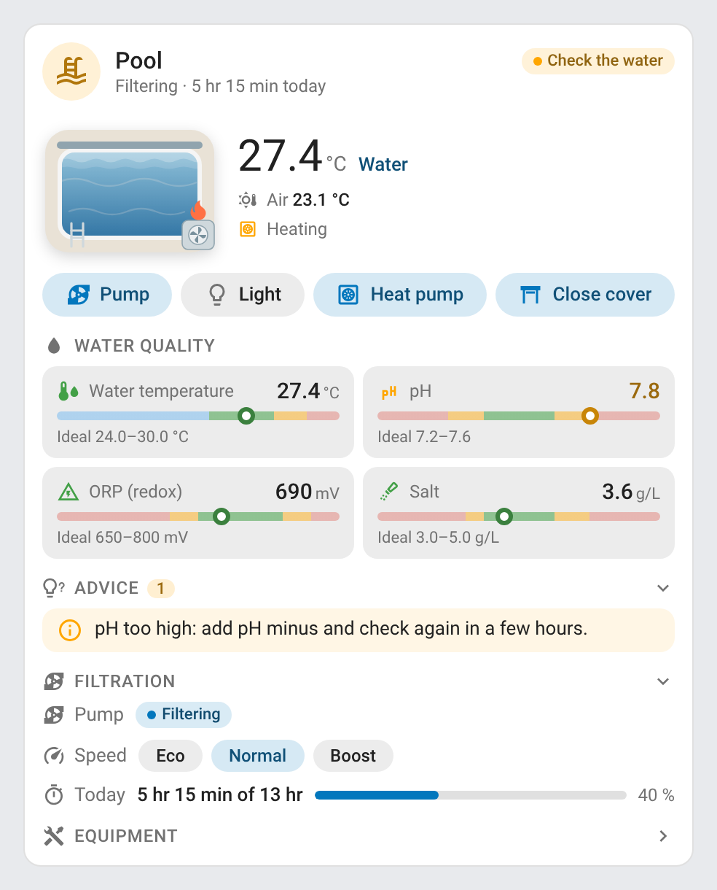 | 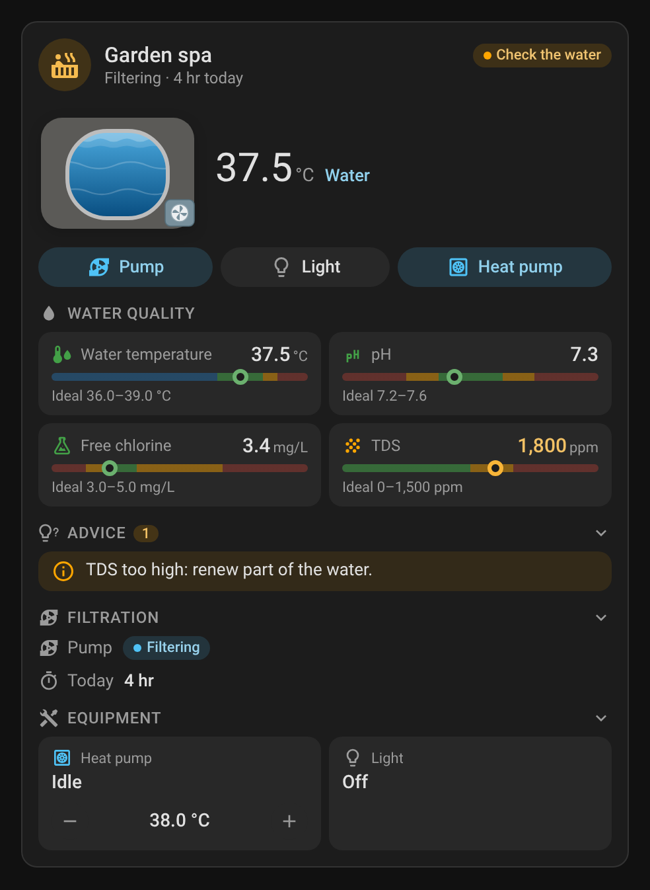 |
| 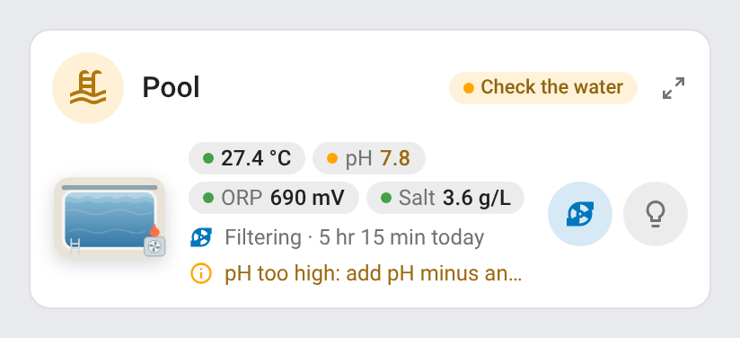 | 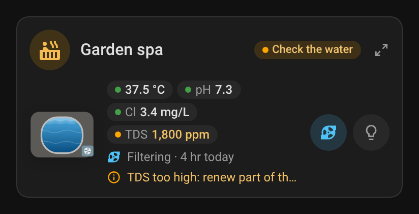 |

## Features

- Two cards: a full **Pool Card** (`custom:pool-card`) and a compact **Pool Mini Card** (`custom:pool-mini-card`), for a pool or a spa (`kind`, guessed from the name)
- Animated scene of the pool (or of the round spa) on its deck: the water ripples and a current crosses it while the pump filters, bubbles rise in a spa, the heat pump spins its fan and its flame flickers while it heats, the underwater light glows in its color, the roller cover unrolls and rolls back; the water turns teal on a critical value and green when the disinfection is too low (see [Animations](#animations))
- Header icon (pool or spa) in a round badge colored with the water status, and a status pill on the title line: **Water OK**, **Check the water**, **Action needed**; its dot blinks while something runs
- Big water temperature with the air temperature, heating and cover state next to the scene
- Colored gauges for water temperature, pH, ORP, free chlorine, salt and TDS: the ideal range in green, a warning margin in orange, critical beyond it in red (cold water in blue), the value marked on it, the ideal range written under it; all ranges configurable (`ranges`), in the unit of each sensor (°C or °F, g/L or ppm)
- Advice for every value out of its range (pH too high: add pH minus…) and for equipment running without water flow (heat pump heating or electrolyser on while the pump is stopped)
- Filtration: pump state, speed buttons (select or fan presets), time filtered today against a daily target (the `filtration_hours` option, iopool's recommendation, or the classic rule *water temperature ÷ 2*), from a sensor or computed from the pump's history
- Control buttons for the pump, the light, the heat pump, the cover and the electrolyser; heat pump target with − / + buttons; stopping the pump while the heat pump heats (pump button, or the *off* option of its speed select) asks for a confirmation (popup at the top of the card, **Cancel** focused)
- Collapsible sections (advice, filtration, equipment; equipment folded by default), folded back by a click anywhere else on the page
- Detail button on the mini card (top right): it switches the mini card to the full card's content and back; a click anywhere outside the card brings the compact view back
- Click any value to open its Home Assistant history (more-info dialog); buttons disabled while their entity is unavailable
- Visual editor in the dashboard UI for both cards (no YAML needed)
- Light and dark mode, English, French, German, Spanish, Serbian (Cyrillic and Latin), Italian, Dutch, European Portuguese, Polish, Romanian, Danish, Swedish, Bulgarian, Russian, Ukrainian, Hungarian, Slovak, Czech, Slovenian, Latvian and Greek
- Single file, no external dependency, the scene is drawn by the card itself

## Supported integrations

The card reads standard Home Assistant entities: any integration exposing them works. Those below are the usual ones; their entities are found from the device when you pick it.

| Integration | Devices | What the cards show |
|---|---|---|
| [iopool](https://github.com/mguyard/hass-iopool) (custom) | iopool ECO probe | Water temperature, pH, ORP, **filtration recommendation** (target of the day), filtration state (its *Filtration* binary sensor: the time of the day is computed from its history) |
| Blue Riiot / Blue Connect — through [BlueRiiot2MQTT](https://github.com/LordMike/MBW.BlueRiiot2MQTT) or an [ESPHome BLE bridge](https://github.com/alexdelprete/ha-esphome-blueconnect) | Blue Connect, Blue Connect Go | Water temperature, pH, ORP, salinity |
| [ESPHome](https://www.home-assistant.io/integrations/esphome/) (core) | DIY probes and controllers (Atlas Scientific, DFRobot…), spa controllers | Any sensor, switch, select, climate, light and cover, recognized from their names (`ph`, `orp`, `chlorine`, `salt`, `tds`, `pump`, `light`…) |
| [Pentair ScreenLogic](https://www.home-assistant.io/integrations/screenlogic/) (core) | ScreenLogic, IntelliChem, IntelliChlor, IntelliFlo | Air temperature, pH, ORP and salt (IntelliChem and IntelliChlor sensors, filed as diagnostic but found all the same), pool / spa heaters (climate; their current temperature is the water temperature), lights. The filter pump runs with the *Pool* circuit: set that switch as `pump` |
| [Pentair IntelliCenter](https://github.com/jlvaillant/intellicenter) (custom) | IntelliCenter | Water and air temperature, heaters, pump state (binary sensor; set the *Pool* body switch as `pump` to command it), lights, pH, ORP, salt |
| [Hayward OmniLogic](https://www.home-assistant.io/integrations/omnilogic/) (core) | OmniLogic, OmniHub | Water and air temperature, pH, ORP, salt level, filter pump (switch), chlorinator output (electrolyser) |
| [Jandy iAquaLink](https://www.home-assistant.io/integrations/iaqualink/) (core) | iAquaLink | Pool / spa heaters (climate), water and air temperature, pump and aux switches, lights |
| Any other | Shelly / Sonoff switches, `history_stats`, template sensors, helpers | Set each entity in the options: pump, speed, heat pump, electrolyser, light, cover, sensors |

How the card recognizes each entity is detailed in [How it works](#how-it-works).

## Prerequisites

Home Assistant 2024.8 or later, with the pool's sensors available as entities (see [Supported integrations](#supported-integrations)). The filtration time computed from the pump's history needs the pump to be recorded (the default).

## Installation

### Via the Marketplace (recommended)

Click the button below to add the repository directly:

[](https://my.home-assistant.io/redirect/marketplace_repository/?owner=juju35&repository=ha-pool-card&category=plugin)

Then click **Install**, and reload your browser when the Marketplace asks you to.

Or manually:

1. Open **Settings → Marketplace → Add from link** (top right; this needs a GitHub account connected)
2. Add `https://github.com/juju35/ha-pool-card` — Type: **Dashboard**
3. Open **Pool Card** and click **Install**
4. Clear your browser cache and refresh

The Marketplace adds the resource `/local/community/ha-pool-card/pool-card.js` for you.

### Manual

1. Download `pool-card.js` and the `pool-card.i18n.*.js` translation files from the [latest release](https://github.com/juju35/ha-pool-card/releases/latest)
2. Copy them all to `/config/www/` (without the translation files, the cards show in English)
3. Go to **Settings → Dashboards → ⋮ → Resources** → Add resource:
   - URL: `/local/pool-card.js`
   - Type: **JavaScript Module**
4. Clear your browser cache and refresh

## Configuration

### Card types

| Card | Type |
|---|---|
| Pool Card | `custom:pool-card` |
| Pool Mini Card | `custom:pool-mini-card` |

### Visual editor

Edit a dashboard, click **Add card** and search for **Pool Card** or **Pool Mini Card**. The device with the most water quality sensors is preselected; pick another one, set the entities the device does not have under **Entities** (the pump of another brand, the heat pump, the cover…), the ideal ranges, the daily filtration target, the sections and the language. The preview updates live, and options left at their default are kept out of the generated YAML.

### Minimal

```yaml
type: custom:pool-card
```

```yaml
type: custom:pool-mini-card
```

Without any option, the card takes the device with the most water quality sensors.

### Full options

```yaml
type: custom:pool-card
device: Pool
title: Pool
kind: pool
# Entities: each one replaces what the device gives (or completes it)
water_temperature: sensor.pool_temperature
air_temperature: sensor.outdoor_temperature
ph: sensor.pool_ph
orp: sensor.pool_orp
chlorine: sensor.pool_free_chlorine
salt: sensor.pool_salt
tds: sensor.pool_tds
pump: switch.filtration_pump
pump_speed: select.pump_speed
filtration_time: sensor.filtration_today
filtration_target: sensor.pool_filtration_recommendation
heat_pump: climate.pool_heat_pump
electrolyser: switch.pool_electrolyser
light: light.pool_light
cover: cover.pool_cover
filtration_hours: 10
ranges:
  ph_min: 7.0
  ph_max: 7.4
  orp_min: 700
  orp_max: 780
  chlorine_min: 1
  chlorine_max: 2
  salt_min: 4
  salt_max: 6
  water_temperature_min: 26
  water_temperature_max: 29
show_title: true
show_subtitle: true
show_controls: true
show_advice: true
show_filtration: true
show_equipment: true
collapsed:
  - equipment
language: fr
```

```yaml
type: custom:pool-mini-card
device: Garden spa
kind: spa
show_controls: true
zoom: true
```

### Options reference

| Option | Card | Default | Description |
|---|---|---|---|
| `device` | both | Device with the most water sensors | Device of the pool (its name as shown in Home Assistant, or its device id, set by the visual editor): its sensors and equipment are discovered |
| `title` | both | Device name | Card title |
| `kind` | both | `auto` | `pool`, `spa` or `auto` (a spa when the name says *spa*, *jacuzzi*, *hot tub*…): the scene, the icon and the default temperature range |
| `water_temperature` | both | Discovered | Water temperature sensor (else the heat pump's current temperature) |
| `air_temperature` | both | Discovered | Air temperature sensor |
| `ph`, `orp`, `chlorine`, `salt`, `tds` | both | Discovered | Water quality sensors (`chlorine` in mg/L or ppm, or in mV for probes that report it so; `salt` in g/L or ppm) |
| `pump` | both | Discovered | Filtration pump: `switch`, `input_boolean`, `fan` (its preset modes are the speeds), `select` (its options are the speeds, its *off* option stops it) or `binary_sensor` (state only) |
| `pump_speed` | both | Discovered | Speed `select` of the pump |
| `filtration_time` | both | Discovered | Time filtered today (in min, h or s: a `history_stats` sensor, a controller's counter…); without it, computed from the pump's history |
| `filtration_target` | both | Discovered | Daily filtration target (iopool's *Filtration recommendation*) |
| `filtration_hours` | both | — | Daily filtration target in hours, instead of the sensor or of *water temperature ÷ 2* (pool only) |
| `heat_pump` | both | Discovered | Heat pump or heater (`climate`): on / off, target with − / +, heating animation |
| `electrolyser` | both | Discovered | Salt electrolyser: a `switch` (on / off button) or a production `sensor` (in %) |
| `light` | both | Discovered | Pool light (`light` or `switch`): button, glow in the scene in the light's color |
| `cover` | both | Discovered | Pool cover (`cover`): open / close button, drawn at its position, animated while it moves |
| `ranges` | both | See below | Ideal ranges: `<measure>_min` and `<measure>_max` for `water_temperature`, `ph`, `orp`, `chlorine`, `salt` and `tds`, in the unit of the sensor |
| `show_title` | both | `true` | Show the title in the header |
| `show_subtitle` | both | `true` | Show the subtitle (filtration state and time of the day) |
| `show_controls` | both | `true` | Control buttons (pump, light, heat pump, cover, electrolyser; pump and light on the mini card) |
| `show_advice` | full | `true` | Advice section |
| `show_filtration` | full | `true` | Filtration section |
| `show_equipment` | full | `true` | Equipment section |
| `collapsed` | full | `[equipment]` | Sections folded by default, among `advice`, `filtration` and `equipment` (`[]` to unfold everything). Click a section title (or Tab to it and press Enter or Space) to fold or unfold it |
| `zoom` | mini | `true` | Detail button at the top right of the mini card: it shows the full card's content (with the same options) and switches back; a click outside the card also brings the compact view back. `false` removes the button |
| `language` | both | Auto | Force language: `fr`, `en`, `de`, `es`, `sr`, `sr-Latn`, `it`, `nl`, `pt`, `pl`, `ro`, `da`, `sv`, `bg`, `ru`, `uk`, `hu`, `sk`, `cs`, `sl`, `lv` or `el` (auto-detects from HA settings) |

### Default ideal ranges

| Measure | Ideal | Warning margin (beyond: critical) |
|---|---|---|
| Water temperature, pool | 24–30 °C | 3 °C above (below: cold, in blue) |
| Water temperature, spa | 36–39 °C | 1 °C above, critical above 40 °C (below: cold, in blue) |
| pH | 7.2–7.6 | 0.2 (critical outside 7.0–7.8) |
| ORP | 650–800 mV | 50 mV (critical below 600 mV) |
| Free chlorine, pool | 1–3 mg/L | 0.5 below, 2 above (critical above 5 mg/L) |
| Free chlorine, spa | 3–5 mg/L | 1 below, 5 above (critical above 10 mg/L) |
| Salt, in g/L | 3–5 g/L | 0.5 below, 1 above |
| Salt, in ppm | 2700–3400 ppm | 400 below, 600 above |
| TDS | 0–1500 ppm (salt pool: its salt + 1500 ppm) | 500 ppm |

These follow the CDC (free chlorine at least 1 ppm in a pool and 3 ppm in a hot tub, pH 7.0–7.8), the CDC Model Aquatic Health Code (ORP 600–900 mV, chlorine 10 ppm at most), the WHO (ORP around 720 mV) and the US hot tub limit of 40 °C (104 °F). The salt range depends on the electrolyser: a sensor in ppm (Pentair, Hayward and Jandy controllers) gets the 2700–3400 ppm of their cells, one in g/L the 3–5 g/L of most European ones. The TDS of a salt pool includes its salt, so its ideal maximum is the salt level plus 1500 ppm (3000 ppm assumed with an electrolyser and no salt sensor).

Temperatures in °F are converted. Set your own ideal ranges with `ranges` (or **Ideal ranges** in the visual editor), for instance the salt range of your electrolyser's manual.

## Screenshots

### Animations

The scene animates to match what the pool is doing and settles back to a still picture once nothing runs. Each state plays its own animation, and every one of them honours `prefers-reduced-motion`.

While the pump filters, the water ripples and the return jets push a current across the pool (the status dot blinks):

| Light | Dark |
|---|---|
|  | 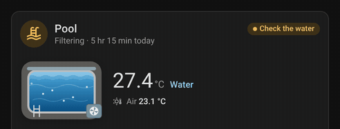 |

While the heat pump heats, its fan spins, its flame flickers and the water glows warm:

| Light | Dark |
|---|---|
| 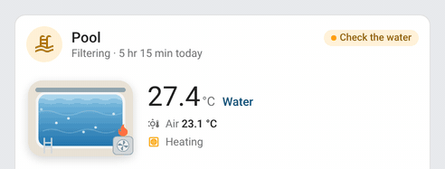 | 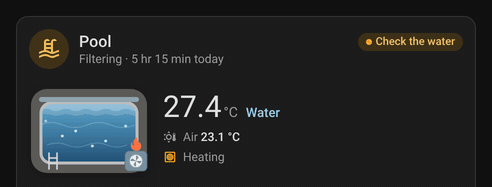 |

With the light on, the underwater light glows and pulses in its color:

| Dark | Light |
|---|---|
| 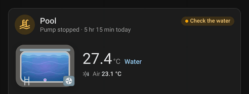 | 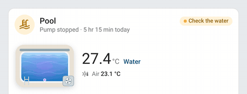 |

The roller cover unrolls over the pool while it closes, and rolls back while it opens (drawn at its position otherwise):

| | Closing | Opening |
|---|---|---|
| Light | 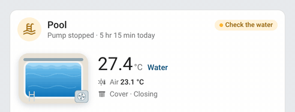 | 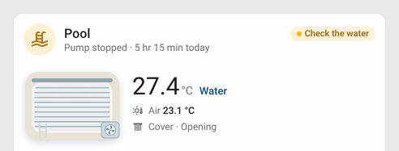 |
| Dark | 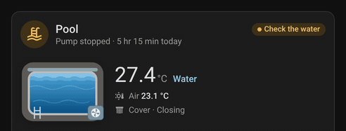 | 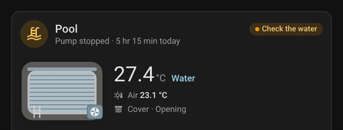 |

In a spa with its pump on, bubbles rise everywhere:

| Dark | Light |
|---|---|
| 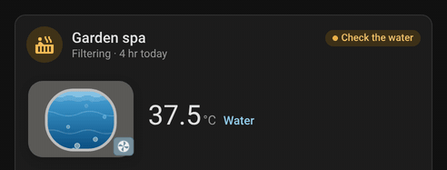 | 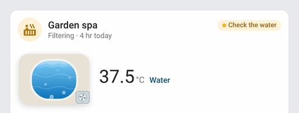 |

### Pool

Pool measured by an iopool probe, with its pump, speed select, heat pump, electrolyser, light and cover set in the options — the pH is a little high, so the status asks to check the water and the advice says what to do:

| Light | Dark |
|---|---|
|  | 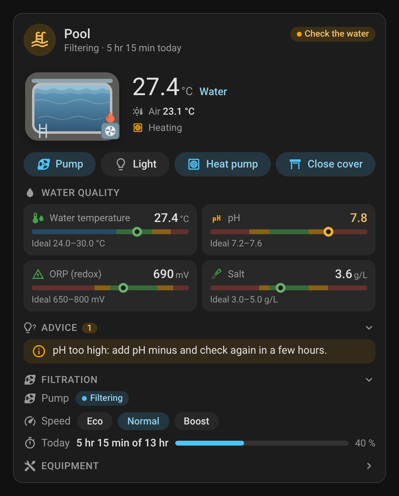 |
|  | 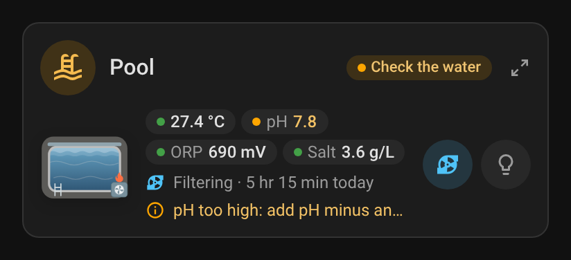 |

Mini card zoomed in with its detail button (top right, click it again or anywhere outside the card to go back):

| Light | Dark |
|---|---|
| 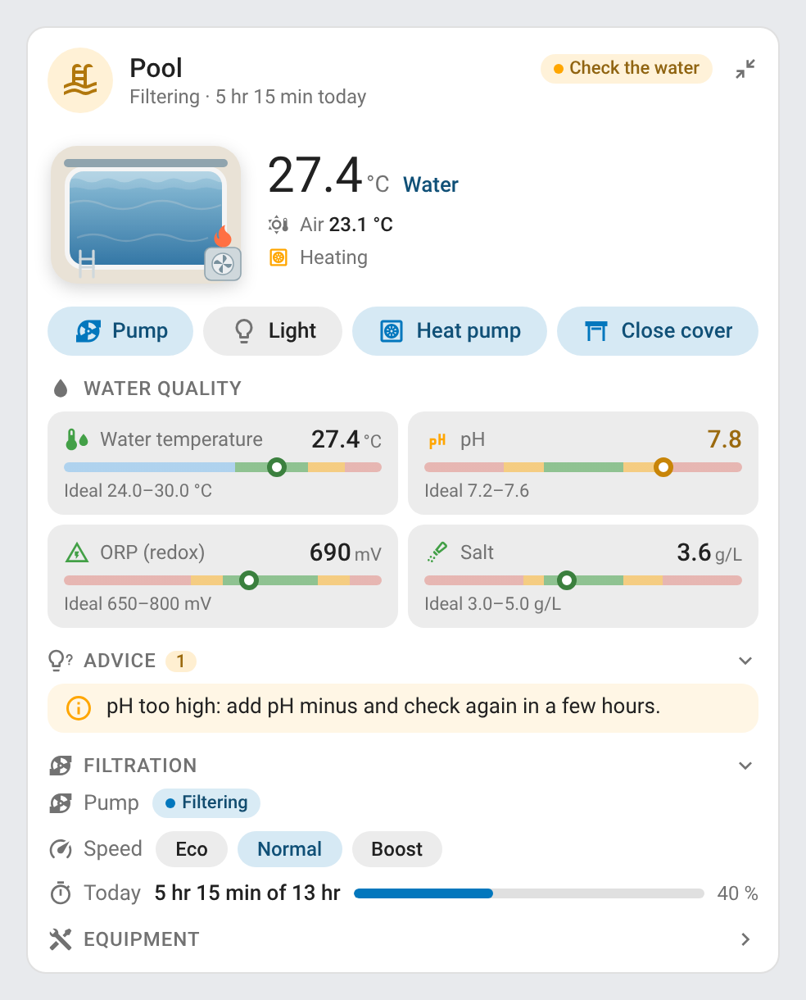 | 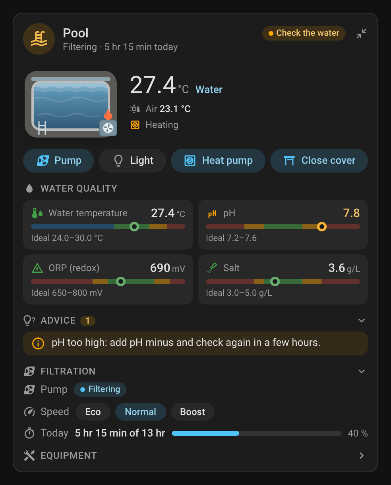 |

A pool that needs care: the ORP is far too low (the water turns green), the salt is low, the pump is stopped and the cover half closed; equipment section unfolded:

| Light | Dark |
|---|---|
| 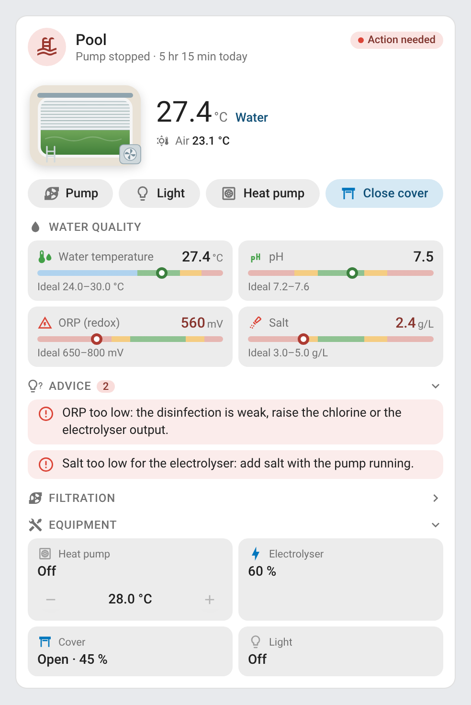 | 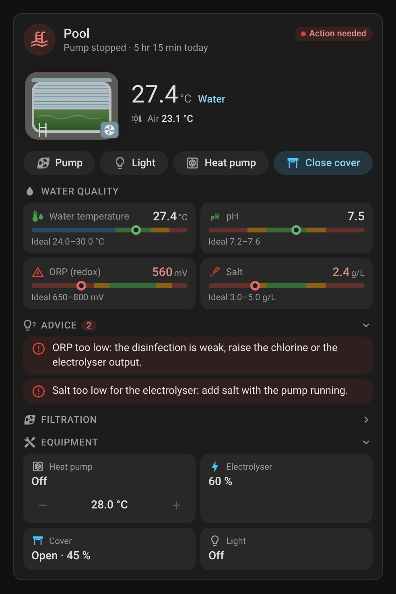 |

Equipment section unfolded, advice and filtration folded (chevron to the right when folded, down when unfolded):

| Dark | Light |
|---|---|
| 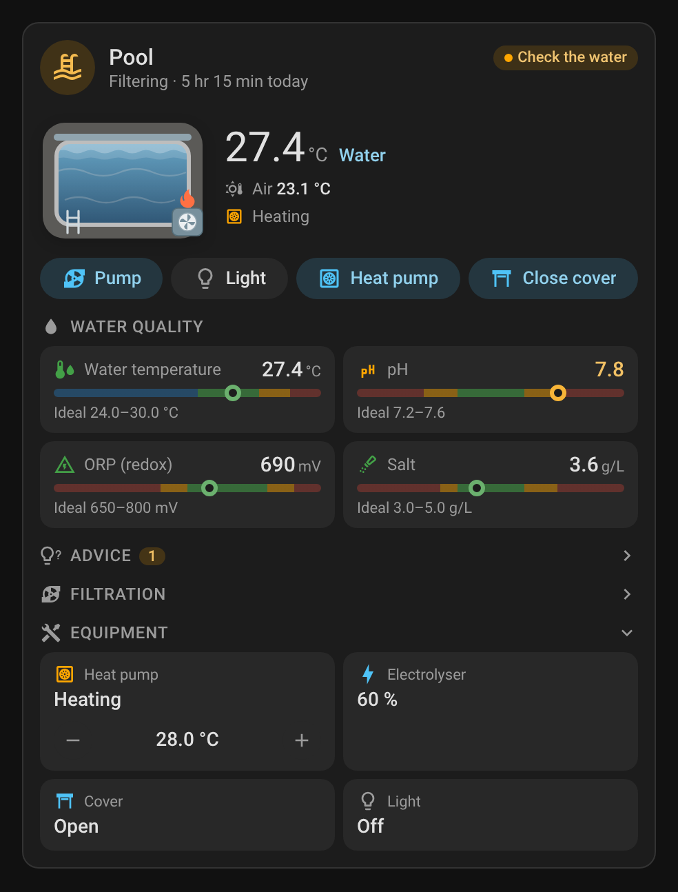 | 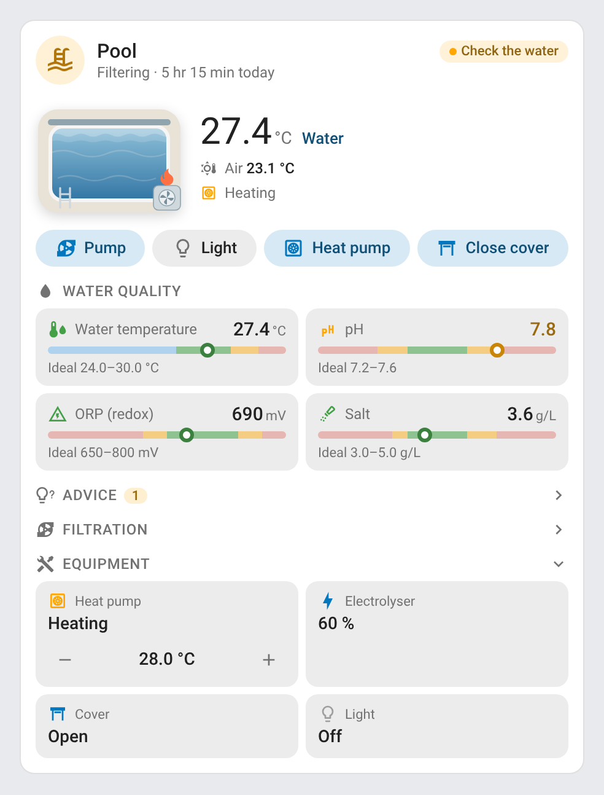 |

Stopping the pump while the heat pump heats asks first, in a popup at the top of the card:

| Light | Dark |
|---|---|
| 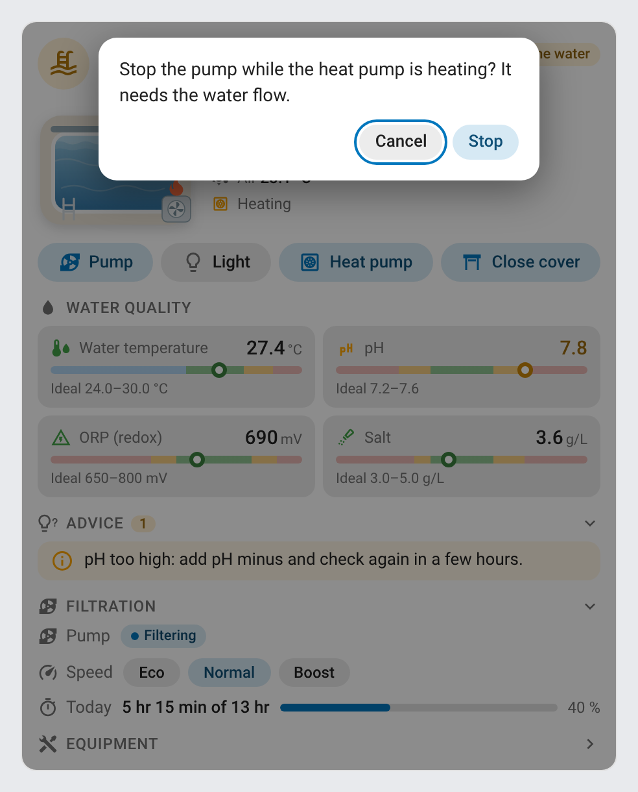 | 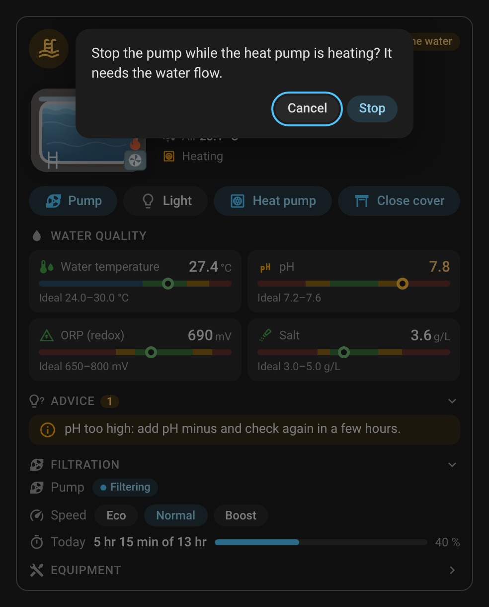 |

Narrow cards on a phone: the full card at 6 of 12 columns of a Sections view (238 px), the gauges and tiles in one column, and the mini card at 170 px, its buttons under the values and its scene giving way:

| Light | Dark |
|---|---|
| 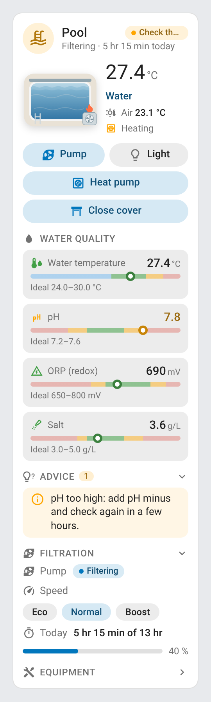 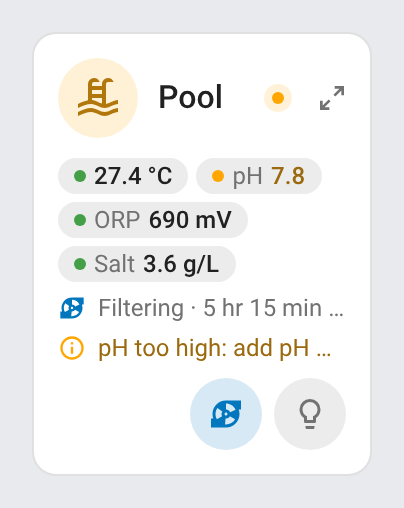 | 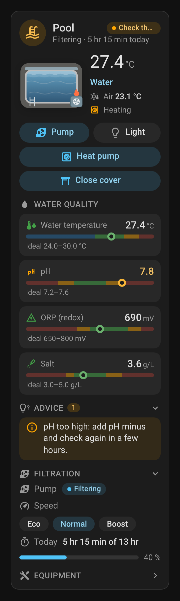 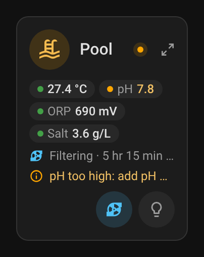 |

### Spa

Spa built with ESPHome, every entity found from its device (temperature, pH, free chlorine, TDS, pump, heater, light); the filtration time of the day is computed from the pump's history, and the TDS calls for a partial water change:

| | Card | Mini card |
|---|---|---|
| Dark |  |  |
| Light | 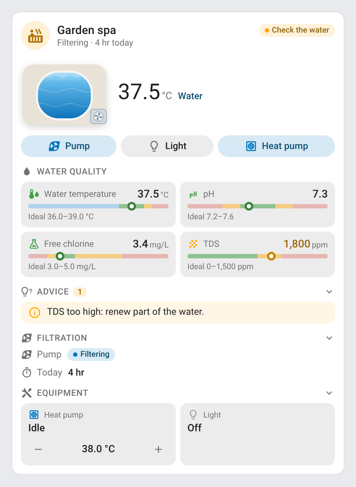 | 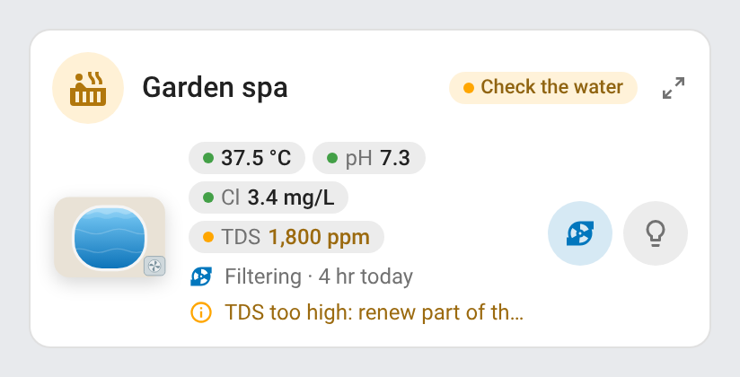 |

## How it works

With a `device`, the card goes through the entities of that device in the Home Assistant entity registry and gives each one a role from its domain, device class, unit and names (entity id, translation key, names; the English names of the integrations, and a few French, German and Spanish words for ESPHome and template entities):

| Role | Recognized as |
|---|---|
| `water_temperature` / `air_temperature` | A `temperature` sensor; *air*, *outdoor*, *ambient*… in its name for the air; one named *water* / *pool* first; set points, *desired* temperatures and the controller's own (*internal*, *cpu*, *solar*…) left out |
| `ph` | Device class `ph`, or *ph* as a word in its name, without a unit or in pH |
| `orp` | *orp*, *redox*, *red_ox* (in mV), or any other sensor in mV |
| `chlorine`, `salt`, `tds` | *salt* / *sel* / *salinity* (in g/L, ppm or mg/L, checked before the chlorine: *Chlorinator salt* is salt), *chlor* (in mg/L, ppm or mV), *tds* (in ppm or mg/L) in the name. Set points, supply and tank levels, dosing states and volumes, alarms are never a measure |
| `filtration_time` / `filtration_target` | A *filtration* sensor in min, h or s; *recommendation* / *target* for the target |
| `pump`, `pump_speed` | A switch, fan, select or binary sensor named *pump*, *pompe*, *filtration* — not a heat pump, a dosing (pH, chlorine, acid) pump, a booster or a cleaner; a switch first, a binary sensor (state only) last; a select named *speed* for the speed |
| `heat_pump`, `light`, `cover` | The `climate`, `light` and `cover` entities (and switches named *light*) |
| `electrolyser` | A switch named *electrolyser* / *chlorinator* (not *superchlorinate*), or a *chlorinator* / *production* sensor in % |

Configuration, disabled and hidden entities are left out, and so are diagnostic ones except water measures (ScreenLogic files its chemistry sensors there). Any role set in the options replaces the discovered one, so the card also works with no device at all, entity by entity.

The **status** is the worst level of the water quality gauges (a cold water counts as in range) and of the advice. The **filtration time of the day** comes from the `filtration_time` sensor, or else from the pump's history since midnight (read with the `history/history_during_period` websocket command at most every 5 minutes and whenever the pump changes state, the time since added while it runs). The **target** is `filtration_hours`, else the `filtration_target` sensor, else, for a pool, half the water temperature in °C (27 °C → 13.5 h, rounded to the degree).

## Development

```bash
npm install
npm run build        # bundles src/pool-card.js into dist/pool-card.js (+ one translation file per language)
npm run check        # builds and checks the card (run in CI)
npm test             # unit tests (node --test)
npm run screenshots  # renders the cards (and one GIF per animated state, needs ffmpeg) with mock data into screenshots/
```

`dist/` is not committed: `npm run build` creates it locally, CI builds it on every push, and the release workflow attaches the built files to the release, which is where the Marketplace installs it from. The screenshots are rendered by the **Screenshots** workflow on pull requests and committed to the pull request's branch.

### Releasing

1. Bump `version` in `package.json` (and `package-lock.json`, with `npm install`)
2. Add a `## <version>` section at the top of [CHANGELOG.md](https://github.com/juju35/ha-pool-card/blob/main/CHANGELOG.md)
3. Push to `main`: the **Release** workflow builds the card, creates the tag and the GitHub release with the changelog section as notes, and attaches `pool-card.js` and its translation files

## Translations

The cards auto-detect the language from your Home Assistant settings. Currently supported:

| Language | Code |
|---|---|
| English | `en` |
| Français | `fr` |
| Deutsch | `de` |
| Español | `es` |
| Српски | `sr` |
| Srpski (latinica) | `sr-Latn` |
| Italiano | `it` |
| Nederlands | `nl` |
| Português (European; also used for `pt-BR`) | `pt` |
| Polski | `pl` |
| Română | `ro` |
| Dansk | `da` |
| Svenska | `sv` |
| Български | `bg` |
| Русский | `ru` |
| Українська | `uk` |
| Magyar | `hu` |
| Slovenčina | `sk` |
| Čeština | `cs` |
| Slovenščina | `sl` |
| Latviešu | `lv` |
| Ελληνικά | `el` |

Contributions for additional languages are welcome!

## Credits

iopool, Blue Riiot / Blue Connect, Pentair, ScreenLogic, IntelliCenter, Hayward, OmniLogic, Jandy and iAquaLink are trademarks of their respective owners. This project is not affiliated with any of them. Icons from [Material Design Icons](https://pictogrammers.com/library/mdi/).

The advice is general guidance for the usual chlorine and salt pools: always follow the instructions of your equipment and products.

## License

[MIT](https://github.com/juju35/ha-pool-card/blob/main/LICENSE)

## Support

If you find this project useful, you can support its development:

<a href="https://buymeacoffee.com/julienstep9"></a>
